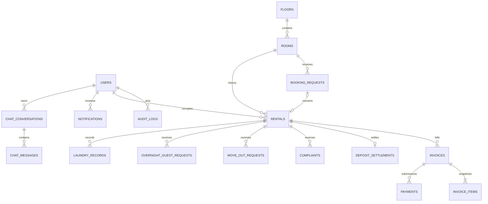

> Historical dashboard design. The current MyKost account flow supersedes the authentication and registration sections below: both tenants and managers register directly with username/password, backed by Netlify Database. Manager registration grants immediate operational access. The shared catalog panel persists bookings, complaints, and room status; the React dashboard retains unfinished module placeholders. See readme.md for current behavior.

# MyKost — rancangan fondasi dashboard Manager

Status: fondasi dashboard disetujui dan diimplementasikan; rancangan data serta modul transaksi masih menunggu persetujuan.

## Keputusan pemilik

Dashboard ditujukan untuk operasional Netlify, bukan demo. Netlify Identity disetujui sebagai pengganti ASP.NET Core Identity. React tetap digunakan. Data persisten menggunakan Netlify Database/Postgres dengan Drizzle; API menggunakan Netlify Functions. SQL Server, EF Core, dan autentikasi Windows lokal tidak digunakan pada jalur Netlify ini.

## Batas tahap implementasi pertama yang diusulkan

Tahap pertama hanya membuat scaffolding React, halaman login dan callback Identity, endpoint health, pemeriksaan sesi/role di backend, serta kerangka dashboard. Tidak ada migrasi, booking approval, verifikasi pembayaran, transaksi finansial, bootstrap SuperAdmin, atau deploy pada tahap ini. Marker aktivasi Identity ditambahkan agar workflow deployment mengaktifkan layanan saat deploy. Pembuatan akun Manager tetap khusus SuperAdmin pada tahap berikutnya.

Dashboard yang belum terhubung ke data tidak menampilkan nol atau angka contoh seolah-olah hasil query. Tampilkan “Data belum tersedia” dan alasan yang jelas. Akun tanpa role Manager/SuperAdmin ditolak backend, walaupun pengguna membuka URL dashboard langsung. Tidak ada tombol yang memberikan role kepada diri sendiri.

## Struktur dan pelestarian file

File demo index.html dan readme.md yang ada tetap dipertahankan. Frontend baru berada di KostPor/frontend/; API di netlify/functions/; kode domain dan akses di server/; schema yang kelak disetujui di db/schema.ts; migrasi kelak di netlify/database/migrations/. Konfigurasi situs yang mengalihkan halaman publik ke frontend baru menunggu persetujuan pergantian. Tidak ada rename folder KostPor menjadi MyKost.

## Arsitektur akses

Browser React → HTTPS /api/* → Netlify Functions → Drizzle → Netlify Database.

Netlify Identity menangani identitas dan sesi. Backend memverifikasi sesi provider, menolak akun nonaktif, dan memeriksa role yang hanya dapat ditetapkan server. Metadata yang dapat diedit pengguna tidak dipercaya sebagai role. Logout, refresh, callback konfirmasi/recovery, dan penerimaan undangan harus memiliki alur eksplisit. Role tidak dianggap valid hanya karena tersimpan pada browser.

| Resource | Public | Tenant | Manager | SuperAdmin |
| --- | --- | --- | --- | --- |
| Katalog Available, profil, aturan | Baca | Baca | Baca | Baca/kelola sesuai modul |
| Dashboard operasional | Tolak | Tolak | Baca | Baca |
| Booking, kamar, pembayaran, operasional | Request publik terbatas | Milik sendiri sesuai modul | Kelola | Kelola |
| Bukti privat | Tolak | Milik sendiri | Akses operasional | Akses operasional |
| Membuat Manager | Tolak | Tolak | Tolak | Diizinkan |
| Rekening, profil, peraturan | Informasi publik yang aman | Informasi pembayaran yang diizinkan | Baca yang diperlukan | Kelola |

## Susunan dashboard akhir

1. Total kamar dan hitungan Available, Reserved, Occupied, Maintenance; filter membuka daftar kamar yang sesuai.
2. Antrean booking Pending dan pembayaran Submitted.
3. Warning invoice hari ke-35 tanpa pengakhiran otomatis.
4. Komplain aktif, move-out, izin tamu menginap, serta chat belum dibaca.
5. Pemasukan Sewa: hanya komponen sewa dari pembayaran terverifikasi, tanpa deposit; bulan kosong Rp0 sejak awal operasi sampai bulan berjalan.

Layout menggunakan navigasi samping pada desktop dan menu ringkas pada browser Android. Status selalu memiliki teks, bukan warna saja. Loading, empty, error, retry, dan akses ditolak dibedakan. Tindakan berisiko memerlukan konfirmasi dan alasan sesuai aturan. Manager tidak memperoleh menu administrasi rekening atau pembuatan Manager.

## Kontrak endpoint bertahap

| Endpoint | Akses | Hasil |
| --- | --- | --- |
| GET /api/health | Public | Status layanan tanpa rahasia/configuration dump |
| GET /api/me | Sesi valid | Identitas minimum, status akun, izin terverifikasi |
| GET /api/manager/dashboard | Manager/SuperAdmin aktif | Snapshot ringkasan dan waktu pengambilan data |
| GET /api/manager/rooms?status=&floor=&cursor= | Manager/SuperAdmin aktif | Daftar berpaginasi dengan filter tervalidasi |
| GET /api/manager/bookings | Manager/SuperAdmin aktif | Antrean booking |
| GET /api/manager/payments | Manager/SuperAdmin aktif | Antrean bukti yang memerlukan verifikasi |
| GET /api/manager/invoices | Manager/SuperAdmin aktif | Invoice dan warning |
| GET /api/manager/rental-income | Manager/SuperAdmin aktif | Deret bulanan setelah dasar laporan disetujui |
| GET /api/files/:id | Ownership/role terverifikasi | File privat, bukan URL storage publik |

Hanya health dan pemeriksaan sesi termasuk tahap scaffolding. Endpoint operasional menunggu schema disetujui. Anonymous mendapat 401, role tidak sesuai mendapat 403, konflik state mendapat 409. Respons privat menggunakan Cache-Control: private, no-store. Daftar memakai batas halaman dan urutan stabil. Nominal decimal dikirim sebagai string. Aktor tidak diambil dari userId yang dikirim client.

## Model data dan integritas untuk tahap desain berikutnya

Ini ERD logis, belum schema fisik yang disetujui. Semua tabel utama memakai UUID PK, timestamp kejadian timestamptz UTC, tanggal bisnis date, nominal numeric(18,2), status enum/check, dan FK transaksi dengan RESTRICT. Profil pengguna menautkan identity subject unik; tidak menyalin password atau token provider. Data historis tidak dihapus ketika akun dinonaktifkan.

Constraint yang harus dirinci pada ERD fisik: nomor kamar unik per lantai, satu booking yang disetujui aktif per kamar, satu rental yang memblokir kamar, satu rental per booking, satu invoice per rental/billing sequence, satu pembayaran Approved per invoice, dan deduplication key notifikasi unik. Lock kamar dalam transaksi menjadi pengaman lintas booking/rental. Harga invoice, deposit, rekening tujuan, dan versi aturan disnapshot; perubahan master tidak menulis ulang histori. Partial payment ditolak.

Pemisahan fasilitas kamar/lantai dipertahankan; water heater/kitchen tidak ditempatkan pada level tertentu tanpa jawaban pemilik. Desain field lengkap, nullability, index, FK, dan delete behavior seluruh modul harus disetujui sebelum schema/migrasi dibuat.

## State dan pekerjaan terjadwal

Booking: Pending → Approved → Confirmed; cabang Rejected/Cancelled/Expired. Pending tidak mengunci kamar. Approval atomik mengubah Available → Reserved dan menetapkan deadline 24 jam. Bukti tepat waktu menahan Reserved selama verifikasi. Retry bukti ditolak menunggu kebijakan pemilik.

Payment: Submitted → Approved atau Rejected. Invoice Paid hanya setelah approval penuh. Submission ditolak tetap disimpan.

Room: Available → Reserved → Occupied; expiry → Available; pengakhiran tunggakan → Maintenance → Available setelah inspeksi Manager. State setelah exit normal menunggu konfirmasi.

Rental: PendingPayment → Active → MoveOutRequested → Ended, atau Active → TerminatedForOverdue. Invoice baru tidak dibuat setelah akhir rental.

Invoice: Unpaid → PendingVerification → Paid; penolakan bukti tidak melunasi invoice. Status overdue dan cut-off final menunggu keputusan hari ke-35.

Deposit: Held → Refunded/PartiallyRefunded untuk exit normal; Held → Forfeited untuk pengakhiran karena tunggakan. Deposit hangus tidak mengurangi utang.

Move-out: Pending → Approved/Rejected; Approved → Completed setelah kewajiban review/deposit/utang dipenuhi atau override beralasan. Kebijakan review dan state kamar belum final.

Scheduled Functions diusulkan memproses pekerjaan yang jatuh tempo dari database dengan transaksi, constraint unik, deduplication key, dan catch-up setelah downtime. Tidak memakai timer memori sebagai satu-satunya scheduler. Interval job belum ditetapkan sebelum zona waktu dan cut-off disetujui.

## File, chat, dan keamanan

Bukti transfer/refund serta foto komplain disimpan dalam Netlify Blobs dan hanya dilayani endpoint berotorisasi. Metadata file di database mencatat pemilik, resource, ukuran, tipe konten, dan storage key acak. Validasi backend memeriksa isi file; batas ukuran dan tipe masih menunggu keputusan. Data rekening nyata tidak ditulis di source.

SignalR memerlukan backend .NET yang berjalan sesuai kebutuhan koneksi; tidak diasumsikan tersedia pada Functions. Transport chat harus dibahas sebelum modul chat. Polling tidak disebut memenuhi syarat real-time SignalR.

## Verifikasi dan tahapan

Tahap scaffolding memeriksa syntax/type, health handler, 401 untuk anonymous, 403 untuk Tenant, dan akses Manager/SuperAdmin. Login/callback Identity perlu pengujian pada lingkungan deploy yang disetujui; autentikasi tidak diemulasi dengan akun palsu di local development. Build dijalankan sistem platform, bukan secara manual pada tahap ini.

Tahap domain berikutnya menguji concurrent approvals, bukti tepat waktu, pembayaran penuh, snapshot harga, invoice idempotent, warning satu kali, penghentian rental, pelestarian utang, ownership file/chat, dan laporan yang mengecualikan deposit serta mencakup bulan Rp0.

Sebelum backend transaksi dibuat, keputusan tertunda mencakup zona waktu, deadline registrasi, retry bukti, cut-off hari ke-35, basis laporan, move-out/review, durasi tamu, fasilitas, aktivasi ulang akun, batas upload, dan transport chat. Keputusan ini tidak menghalangi scaffolding tanpa database, tetapi menghalangi penerapan aturan bisnis terkait.
